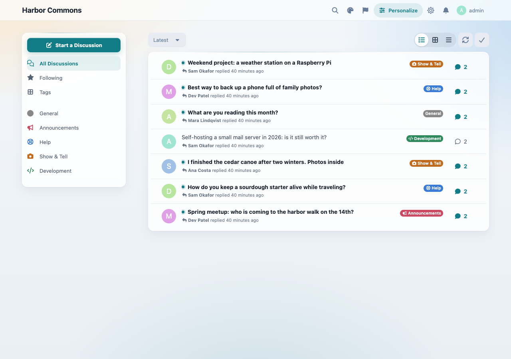
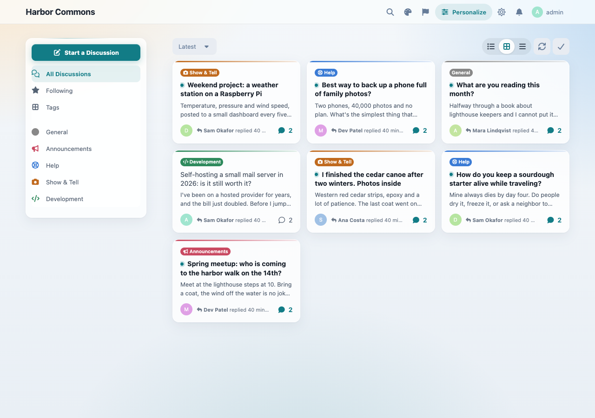
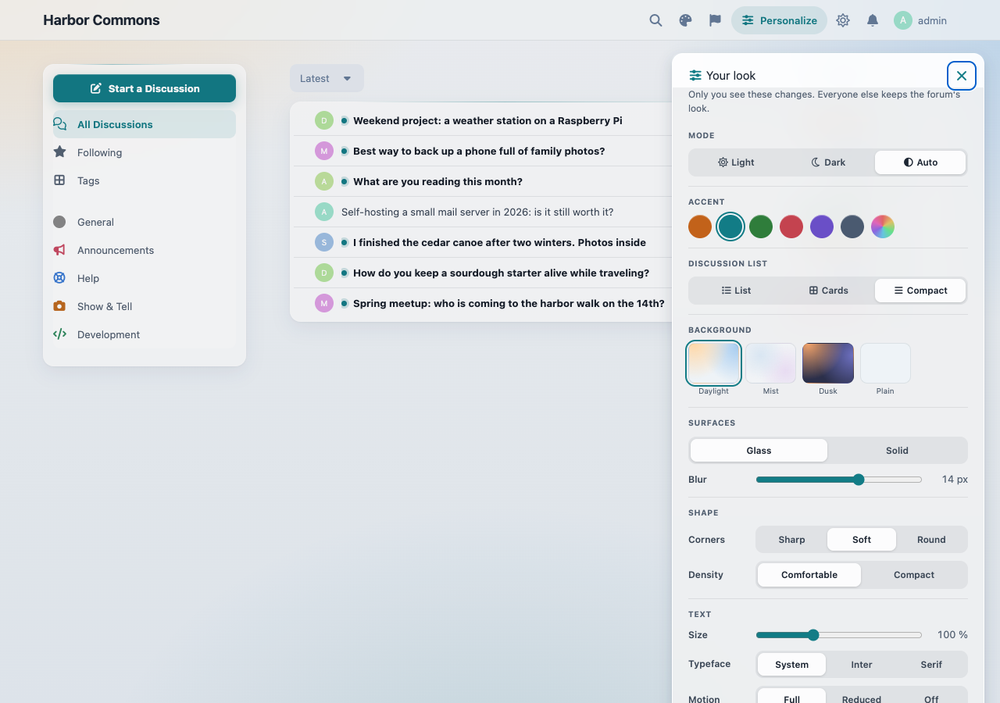
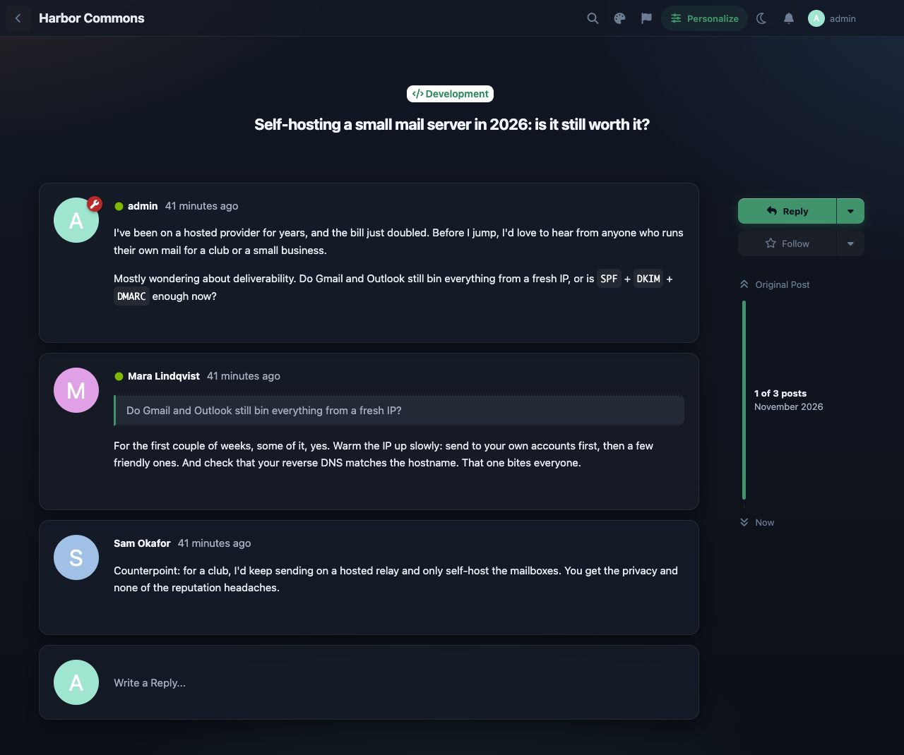
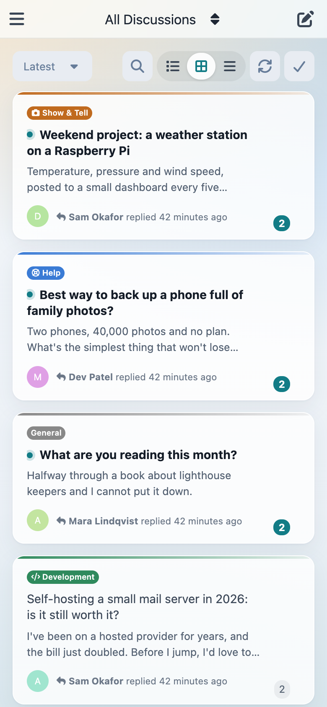
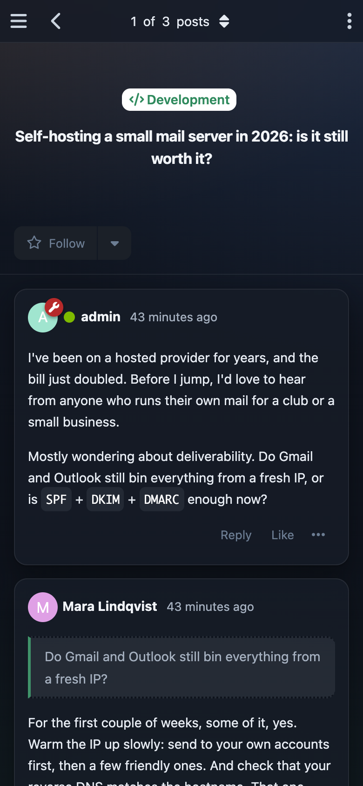
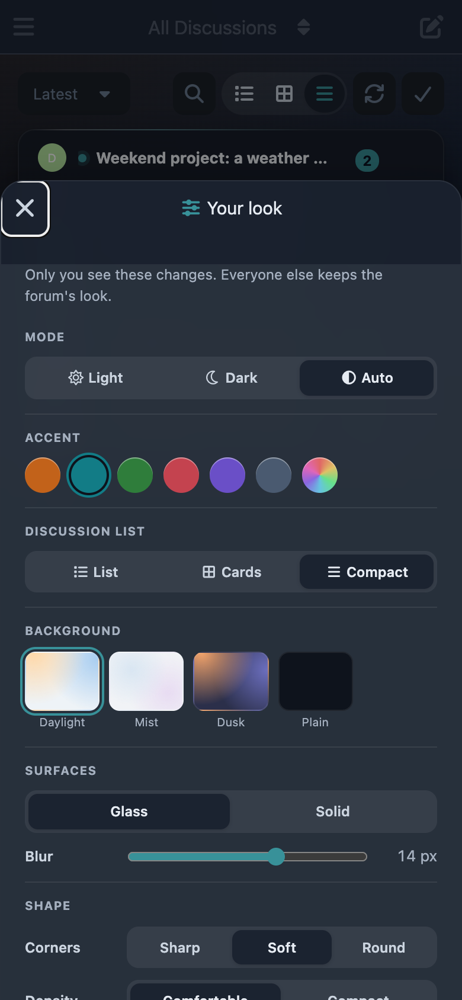
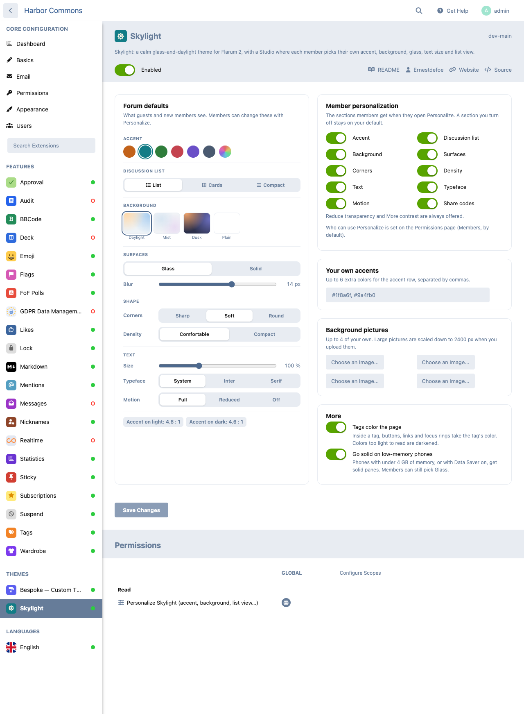

# Skylight

A calm glass-and-daylight theme for Flarum 2, where each member can pick their own look.

- **Glass panes on a daylight sky** — frosted panes with a thin line of light along their top edge, over a soft sky that never moves. Flarum's own layout, untouched.
- **Personalize** — members pick their accent, light or dark, background, glass or solid, corners, density, text size, typeface and motion. They see it change as they pick, and nobody else's view changes.
- **Three list views** — List, Cards (with a two-line excerpt) and Compact, switched from the toolbar.
- **Tags color the page** — inside a tag, buttons, links and focus rings take the tag's color.
- **Readable on purpose** — every accent is nudged until text in it reaches 4.5:1, and Reduce transparency and More contrast are always on offer.









| Cards on a phone | A discussion on a phone | Personalize on a phone |
| --- | --- | --- |
|  |  |  |

## Install

```sh
composer require ernestdefoe/skylight
```

Then enable **Skylight** in your admin panel.

## Settings

- **Forum defaults:** what guests and new members see, set with the same controls members get, with the accent's contrast shown as you pick.
- **Member personalization:** which sections members may change. A section you turn off stays on your default. Reduce transparency and More contrast are always offered.
- **Who can personalize:** the *Personalize Skylight* permission (Members by default; give it to Guests and they keep their look in their browser).
- **Your own accents:** up to six extra colors.
- **Background pictures:** up to four of your own, scaled down to 2400 px and saved as WebP when you upload them.
- **Tags color the page** and **Go solid on low-memory phones**, both on by default.



## How it stays light

- A member's choices are saved in their user preferences (no new table) and put on the page by the server, so it never flashes the wrong look.
- The Personalize panel loads only when someone opens it. Skylight adds about 6 KB of script and 5 KB of styles (gzipped) to a page.
- Only the header, sidebar, menus and dialogs blur. Discussion rows and posts are see-through fills over a sky that never moves, so a long page costs no more than a short one.
- Phones with under 4 GB of memory, or with Data Saver on, get solid panes, unless the member picks Glass.
- Cards' excerpts are sent only while a visitor is on Cards: one query for the whole page, from opening posts the visitor can see.

## Works with

- [Wardrobe](https://github.com/ernestdefoe/wardrobe): members pick Skylight as their theme, and visitors on another theme get none of Skylight's styles.
- Without Wardrobe, Skylight stays off while [Bespoke](https://ernestdefoe.online/downloads/f/bespoke) styles the forum, so two themes never fight over one page.
- Tags, Flarum's colored header, dark and high-contrast modes, and any extension that adds to the header, list or posts.

## API

- `filter[skylight]=cards` on `GET /api/discussions` asks for each discussion's `skylightExcerpt`. It changes nothing about which discussions come back. It's a filter because the API refuses query parameters it doesn't know.
- `POST /api/skylight/backgrounds/{img1…img4}` and `DELETE` (admins only) upload and remove a background picture. They are core's own logo-upload controllers, pointed at four settings. There's no JSON:API resource because a slot is a setting holding a file path, not a model.

## Licence

MIT. The Inter font: SIL Open Font License (see `assets/fonts`).

☕ [Buy me a coffee](https://buymeacoffee.com/ernestdefoe)
